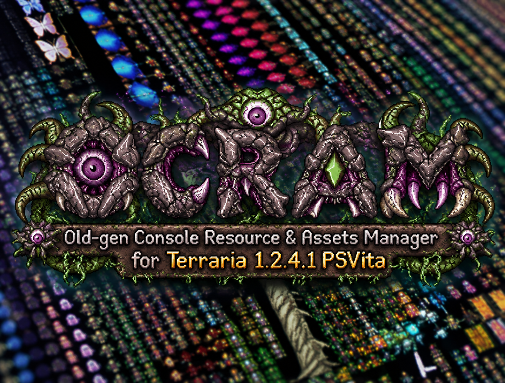
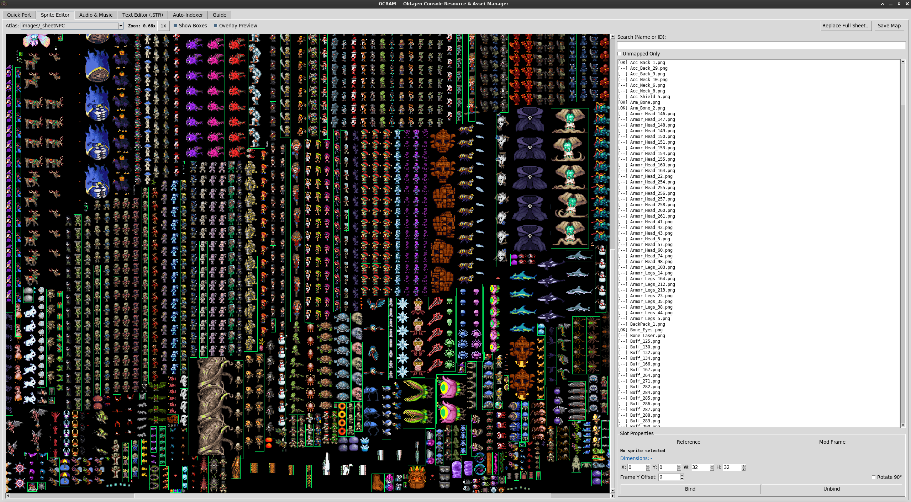
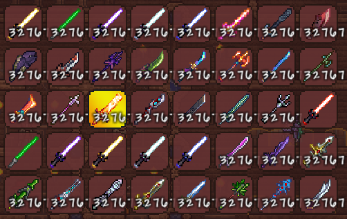
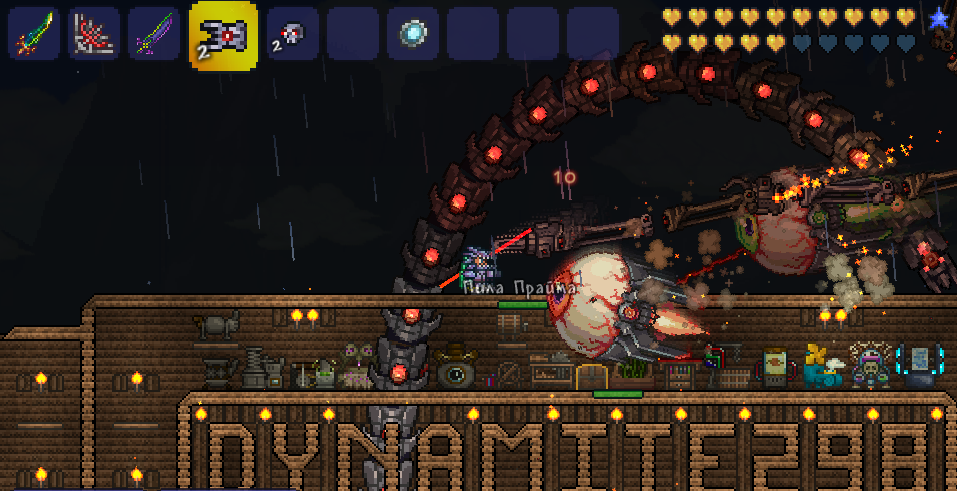

<p align="center">
  
</p>

# OCRAM — Old-gen Console Resource & Asset Manager

**OCRAM** is a standalone, cross-platform GUI modding suite designed to port modern PC **Terraria (1.4.x)** texture packs, sound effects (`.wav` / `.xnb`), music (`.at9`), and localizations (`.str`) to **Terraria on PS Vita (Legacy 1.2.4)**.

---

## Why PC and PS Vita Texture Packs Are Incompatible Out of the Box

Porting assets from modern PC Terraria to the PS Vita edition requires deep format conversion due to fundamental architectural differences:

1. **Loose PNGs vs. Shared Hardware GXT Atlases:**
   - PC Terraria (1.4.x) stores every item, NPC, block, wall, and background as thousands of individual `.png` files.
   - The PS Vita version (developed by Engine Software based on Legacy 1.2.4) packs thousands of sprites tightly into shared Sony `.gxt` texture atlases (`_sheetSprites`, `_sheetNPC`, `_sheetTiles`, `_sheetWalls`, `_sheetSolid`, `_sheetBack`) using hardware-swizzled Morton Z-order layouts.
2. **Color Bit-Depth & Palette Constraints:**
   - Most PS Vita sheets use 16-bit indexed palettes (with normalized UV coordinates mapped to `256x128` or `128x64` grids), while `_sheetNPC` and standalone backgrounds (`_sheetBack93`, `94`, `180`) are restricted to 8-bit (256-color) indexed palettes.
   - Large biome backgrounds (`_sheetBack1..9`) and clouds (`_sheetClouds`) use hardware **DXT1/BC1** and **PVRTC 2bpp** compression.
3. **Sprite Orientation, Frame Counts & Dimensions:**
   - Certain projectiles and items are rotated 90 degrees inside PS Vita atlases.
   - Modern 1.4.x sprites often feature larger canvas sizes or extra animation frames compared to their 1.2.4 console counterparts.
4. **Proprietary Console Container, Audio & Text Formats:**
   - All game assets reside inside a custom `VFS2` archive (`data.vfs`).
   - Sound effects use Sony **HEVAG / PS-ADPCM** (`.vag`), background music uses **Sony ATRAC9** (`.at9`), and localization text is stored in custom binary `.str` tables with 7-bit variable-length offsets.

---
<p align="center">
  
</p>
## Key Features

- **Native VFS2 Unpacker & Repacker (`vfs_handler.py`):** Extracts `data.vfs` and rebuilds valid `VFS2` archives with proper `zlib` compression and uncompressed `.at9` audio alignment.
- **Multi-Format GXT Texture Engine (`gxt_engine.py`):**
  - Decodes and re-encodes 8-bit indexed, 16-bit Morton Z-order indexed, 32-bit `BGRA8888`, swizzled `DXT1/BC1`, and `PVRTC 2bpp` textures across all game folders (`images/`, `ui/`, `fonts/`).
  - **Smart-Fit Patching & Dynamic Palette Allocation:** Automatically trims transparent padding, downscales oversized sprites via Nearest-Neighbor filtering, and allocates new colors into unused palette rows without corrupting vanilla colors.
- **Pre-Mapped Coordinate Database (`vita_atlas_map.json`) & Name Search (`terraria_names.json`):** Ships with thousands of pre-mapped sprites searchable by their actual in-game names.
- **Visual Sprite Editor & Live Overlay:** Inspect atlases, toggle live mod overlay previews, zoom smoothly (`0.25x`–`6.0x` via `Ctrl + Wheel`), adjust animation frame offsets (`Frame Y Offset`), and replace full standalone sheets (`logo*`, UI, backgrounds).
- **Audio & Music Manager (`audio_vag.py`):**
  - Built-in Python encoder for `.wav` / `.xnb` -> PS Vita `.vag` sound effects, with automatic batch conversion during VFS build.
  - One-click **Automatic Downloader** for `vgmstream-cli` (lossless `.vag` & `.at9` playback) and `at9tool.exe` (`.wav` -> `.at9` music encoding with selectable bitrates, running natively on Windows or via `mono`/`wine` on Linux/macOS).
  - Automatic file renaming when replacing individual sounds or music tracks.
- **Binary Text & Localization Editor (`str_handler.py`):** Search, edit, and export/import `strings_*.str` localization files to/from JSON with automatic 7-bit offset recalculation.

---

## Installation & Quick Start

### 1. Install Python Dependencies
Ensure **Python 3.10+** is installed, then run:
```bash
pip install -r requirements.txt
```
*(Note for Linux/macOS users: if you want to auto-encode `.wav` music into `.at9`, install `wine` or `mono` so OCRAM can execute `at9tool.exe`.)*

### 2. Dump Your Decrypted `data.vfs`
- **On PS Vita (via VitaShell):**
  1. Navigate to `ux0:patch/<TITLE_ID>/` (e.g., `PCSE00317` for US or `PCSB00405` for EU — use `patch/` if game updates are installed, or `app/` for the base game).
  2. Highlight the folder, press **Triangle**, and select **Open decrypted** *(mandatory — otherwise `data.vfs` remains PFS-encrypted)*.
  3. Copy the decrypted `data.vfs` to your PC.
- **On Vita3K (Emulator):**
  - Copy `data.vfs` directly from your Vita3K `ux0/patch/<TITLE_ID>/` or `ux0/app/<TITLE_ID>/` directory.

### 3. Build & Install Your Mod

1. Launch OCRAM:
   ```bash
   python main.py
   ```
2. In **Quick Port**:
   - Select your decrypted `data.vfs` and click **Extract Base**.
   - Select your PC Texture Pack folder (root folder or `Content/Images`).
   - Click **Build VFS** to generate your modded `data.vfs`.
3. Copy the generated `data.vfs` to `ux0:rePatch/<TITLE_ID>/data.vfs` on your PS Vita (requires the **rePatch** plugin) or into Vita3K's `rePatch` directory.
<p align="center">
  
</p>
<p align="center">
  
</p>
---

## Legal Disclaimer
This repository contains **zero copyrighted assets** from Terraria, Re-Logic, 505 Games, or Engine Software. External CLI tools (`vgmstream-cli`, `at9tool.exe`) are downloaded on demand by the user from their respective upstream releases and are excluded from this repository.

## Contact me
Telegram - @memoryburner
